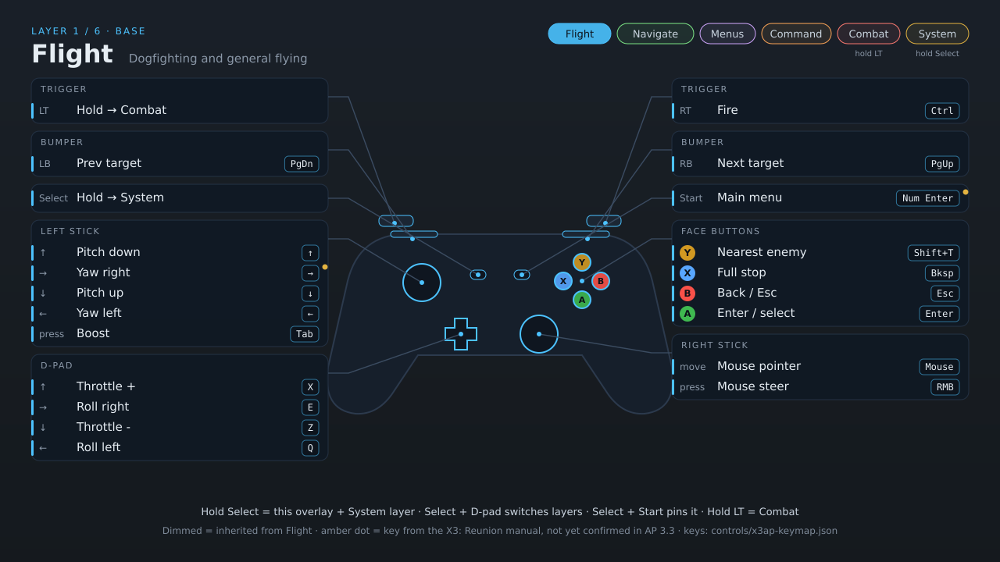

# X3: Albion Prelude + LxXRM on Android (ARM64)

Plan, research and tooling for an Android app that runs **X3: Albion Prelude** with the
**LxXRM 3.1** mod package ([forum thread](https://forum.egosoft.com/viewtopic.php?t=399184&start=15))
on ARM64 handhelds such as the AYN Thor. The goals: working sound, faster loading than
Winlator/GameNative, and a layered controller scheme with an on-demand help overlay. It reuses the
runtime pieces already proven in [trasc-server-android](https://github.com/Russianranger/trasc-server-android).

**Status:** design and tooling. There is no APK yet. The controller profile is validated against
TRASC's real `ControllerInput` engine; everything that needs a device or your game files is marked
*verify* in the docs.



## Answers to the four asks

1. **Plan** -> [docs/01-plan.md](docs/01-plan.md). Fork TRASC's app shell and add a *runtime adapter*
   per route:
   - **Route B** runs the Windows `X3AP.exe` with LxXRM installed exactly as authored, via Wine 10
     WoW64 + Box64 + DXVK/Turnip. This is TRASC's proven ROF2 stack. **Ship this first.**
   - **Route A** runs Egosoft's native Linux `X3AP_main` via Box64 **BOX32**, with no Wine at all.
     It is the ARM-optimised spike, developed in parallel.
2. **Dependencies / ARM** -> [docs/02-dependencies.md](docs/02-dependencies.md). It all runs on
   arm64. X3 is closed x86 code, so the game itself is always translated. On Route A *only* the game
   is: Box32 wraps SDL2, libGL, libasound, OpenAL and X11 to native arm64 libraries. Box86 is not
   needed on either route.
3. **Audio** -> [docs/03-audio.md](docs/03-audio.md). One driver path for both routes: ALSA ->
   TRASC's `pcm_trasc` plugin -> AudioBridge (AudioTrack). Route B forces `winealsa` with
   `winepulse.drv=d`; Route A adds Egosoft's `dsp0` device name. Turn **EAX off** in X3's launcher.
   It is the most likely reason Winlator/GameNative were silent.
4. **Controls** -> [docs/04-controls.md](docs/04-controls.md), [cheat sheet](docs/controls-cheatsheet.md).
   Six layers (TRASC's limit):
   - four base layers: **Flight**, **Navigate**, **Menus**, **Command**;
   - two hold layers: **Combat** (hold LT) and **System** (hold Select).
   - **Help overlay:** holding Select peeks it, and Select + Start pins it.

Loading times: [docs/05-loading-times.md](docs/05-loading-times.md). The likely culprits are FUSE
shared storage, per-file PRoot/Wine lookups on LxXRM's thousands of loose scripts, intro movies, and
JIT warm-up. Preparing the mod folder: [docs/06-lxxrm-prep.md](docs/06-lxxrm-prep.md).
Sources: [docs/sources.md](docs/sources.md).

## Repository map

```text
controls/
  x3ap-keymap.json              action -> X3 key (edit when AP's keys differ)
  x3ap-lxxrm.profile.json       6-layer controller profile (format 3, action-based)
  generated/                    built by tools/build_controls.py: do not edit
    x3ap-lxxrm.trasc-v2.json    loads in TRASC's existing ControllerInput
    overlay-data.json           what the help overlay renders
    v2-compat-report.md         bindings that need the extended vocabulary
overlay/layer-*.svg             overlay cards for each layer (also printable)
runtime/
  asound.conf.template          ALSA -> pcm_trasc (+ dsp0 for the Linux build)
  box64rc.x3                    per-process Box64 starting points
  launch-wine.sh                Route B launcher (inside the rootfs)
  launch-native.sh              Route A launcher (inside the rootfs)
tools/
  build_controls.py             validate + generate all controller artefacts
  trasc_check/                  run the profile through TRASC's real ControllerInput.java
  probe_x3_install.py           read-only inventory of an X3 install (Phase 0)
  normalize_case.py             reversible lowercase pass for Route A (dry run by default)
docs/                           plan, dependencies, audio, controls, loading, mod prep, sources
```

## Using the tools

```sh
python3 -I tools/build_controls.py                     # regenerate profile, overlay, cheat sheet
python3 -I tools/build_controls.py --check             # CI: fail if generated files are stale
tools/trasc_check/run.sh ../trasc-server-android       # prove it on TRASC's engine (needs a JDK)
python3 -I tools/probe_x3_install.py "/path/to/X3 Terran Conflict" --json reports/windows.json
python3 -I tools/normalize_case.py "/path/to/copy" --only addon      # Route A only; dry run
```

## Next steps

Phase 0 in [docs/01-plan.md](docs/01-plan.md): assemble LxXRM on a PC, run the probe on it (and on a
vanilla Linux install if you own one), and commit the reports to `reports/`. Those answers decide how
much of Route A is worth building.
