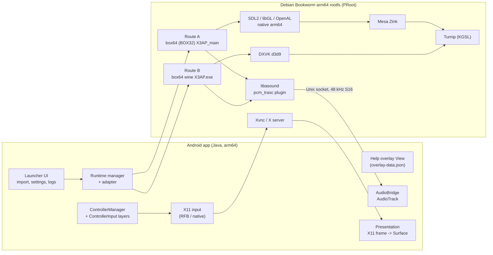

# 1. Orchestration plan

## Goal

An Android app (arm64, sideloaded) that runs **X3: Albion Prelude with the LxXRM 3.1 package** on a
handheld like the AYN Thor (Snapdragon 8 Gen 2 / Adreno 740). It needs working audio, shorter loading
than Winlator/GameNative, and controller-first play with switchable layers and an on-demand help
overlay. The app owns its runtime, like TRASC: no Termux, no root, no PC streaming.

## What "running on ARM" means here

X3 is closed-source x86 code, so its instructions are **always** translated on ARM. The real choice is
how much *else* gets translated:

| | Route A: native Linux build | Route B: Windows build |
| --- | --- | --- |
| Game binary | Egosoft's `X3AP_main`, a 32-bit i386 ELF (SDL2 + OpenGL) | `X3AP.exe`, 32-bit PE, Direct3D 9 |
| Translator | Box64 with **BOX32** (experimental) | Box64 running Wine's x86-64 code + WoW64 for the 32-bit game |
| What runs as native arm64 | SDL2, libGL (Mesa), libasound, OpenAL, X11, libc (wrapped by Box32) | Turnip, X server, and the libraries Box64 wraps for Wine's Unix side |
| Windows API layer | none | Wine 10 WoW64 |
| Graphics | OpenGL -> Mesa **Zink** -> Turnip (Vulkan/KGSL) | D3D9 -> DXVK -> Turnip, the path TRASC already ships |
| Audio | libasound -> `pcm_trasc` -> AudioBridge | dsound -> mmdevapi -> winealsa -> libasound -> `pcm_trasc` -> AudioBridge |
| LxXRM fidelity | data files copied over the Linux install: case-sensitivity and XRM's Linux sound patch to handle | byte-exact, installed by LxXRM's own `SETUP.bat` |
| Maturity | unproven: BOX32 "still experimental" per Box64's wiki | proven: TRASC runs ROF2 (32-bit D3D9) this way with audio and controller input |

**Recommendation:** build one app shell with pluggable *runtime adapters*. Ship **Route B first**,
because it is the lowest-risk way to get a playable game with sound, and every component is already
running on your Thor in TRASC. Run **Route A as a parallel spike**: if BOX32 handles `X3AP_main`, it
removes Wine from the loop entirely, and that is the ARM-native win you are after. A third variant,
**B′**, swaps Box64-translated Wine for an ARM64EC Wine with FEX's WoW64 module. Wine's own code then
runs natively and FEX translates only the 32-bit game. Keep it on the list if Route B's file I/O or
audio mixing turns out to be CPU-bound.

## Architecture

### What to reuse from trasc-server-android

| Need | TRASC component |
| --- | --- |
| Rootfs + PRoot with seccomp acceleration | `native/proot-acceleration.patch`, `RuntimeManager.java`, `runtime/` |
| Box64 + Wine 10 WoW64 image | `client-runtime/Dockerfile` (pins Box64 commit and Kron4ek Wine 10.0 wow64) |
| Turnip + DXVK + device preflight | `vulkan/`, `backend/client_vulkan.py`, docs/client-performance.md |
| Audio | `native/pcm_trasc.c`, `native/audio.Dockerfile`, `AudioBridge.java`, `backend/client_audio.py` |
| Controller layers | `ControllerInput.java` (platform-independent), `ControllerManager.java`, `ControllerDialog.java` |
| Display and overlays | `ClientActivity.java`, `ClientOverlayPosition.java`, Native Surface helper, layer label |
| Logs and diagnostics | log bundle export, presentation and audio metrics |

Strip the server, database, rules, quests, maps and EverQuest-specific DLL and camera work. The
`ControllerInput` engine can be reused unchanged for the first milestone: `tools/trasc_check` proves
the compiled X3 profile loads and behaves correctly on it.

### Runtime adapter contract

Each route implements one adapter (`wine-x3ap`, `native-x3ap`):

- `inspect(gameDir)`: run the logic in `tools/probe_x3_install.py`; refuse obviously wrong folders.
- `prepare(session)`: write `asound.conf` from `runtime/asound.conf.template`, install
  `runtime/box64rc.x3`, and create or reuse the Wine prefix (Route B) or `~/.config/EgoSoft/X3AP`
  (Route A).
- `launch(env)`: the logic in `runtime/launch-wine.sh` / `runtime/launch-native.sh`.
- `stop()`, `logPaths()`, `savePaths()`, `defaultControllerProfile()`.

Save paths to back up:
- Linux build: `~/.config/EgoSoft/X3AP/save`, as used by the x3ui project.
- Windows build: by analogy with the X3: Reunion manual (`My Documents\Egosoft\X3\Save`), expect
  `drive_c/users/<user>/Documents/Egosoft/X3AP/save` in the prefix. **Verify on first run.**

## Phases

Each phase ends with an acceptance check you can run on the Thor and an exported log bundle.

### Phase 0: Inventory and decisions (on PC/desktop + device)

1. Assemble LxXRM on a Windows PC exactly as the thread instructs (docs/06-lxxrm-prep.md).
2. Run `tools/probe_x3_install.py` on (a) the finished Windows install and (b) a vanilla **Linux**
   Terran War Pack install if you own one (GOG Linux installer or Steam's Linux depot). Save both
   JSON reports in this repo under `reports/`.
3. If you have any x86 Linux PC, run vanilla `X3AP_main` there once under
   `strace -f -e trace=openat` to see exactly which file names the native build requests (lowercase
   or as-written). That one log settles Route A's case question.

**Done when:** you know which builds you own, the exact size and file counts, the case-collision
count, and the executable details (`X3AP.exe` LAA flag, `X3AP_main` NEEDED libraries).

### Phase 1: App shell

- Fork TRASC into `io.github.russianranger.x3` (separate app ID so both can be installed).
- Import flow: choose a ZIP or folder through Android's picker, then copy it into **app-private
  internal storage** (never run from `/sdcard`, see docs/05). Show free space; keep one previous
  copy for rollback.
- Settings per profile: route (A/B), resolution (start at 1280x720), launch args, CPU affinity,
  overlay options.

**Done when:** the game folder imports, survives an app update, and the logs export works.

### Phase 2: Route B playable with audio

- Reuse TRASC's Box64 + Wine 10 WoW64 image and DXVK/Turnip; create a dedicated prefix.
- Launch via `runtime/launch-wine.sh` (`winepulse.drv=d` -> winealsa -> `pcm_trasc`).
- First run: set the X3 launcher options (resolution, **EAX off**, input device) with touch or the
  pointer. Then try `X3_ARGS=-skipintro`.
- Record timings (docs/05) on the same save: cold launch, warm launch, save load.

**Done when:** main-menu music, in-flight SFX and comms voices are audible; a late-game LxXRM save
loads; 15 minutes of flight; no audio dropouts in the AudioBridge log.

### Phase 3: Controls, help overlay, text entry

- Load `controls/generated/x3ap-lxxrm.trasc-v2.json` in the unchanged engine first. Then add the
  extended vocabulary (Numpad keys, Pause, help toggle, text input; docs/04-controls.md).
- Help overlay: Android View above the game surface, fed by `controls/generated/overlay-data.json`.
- Text entry: an Android IME commits text as X11 key events (ship and save names need it).
- Walk every row of docs/controls-cheatsheet.md in-game and correct `controls/x3ap-keymap.json`
  where Albion Prelude differs from the X3: Reunion defaults.

**Done when:** every cheat-sheet action triggers in-game; the overlay peeks and pins; no stuck keys
after layer changes, menu opening or app switching.

### Phase 4: Route A spike (native Linux build)

1. Build Box64 with `-DARM_DYNAREC=ON -DBOX32=ON -DSD8G2=ON`.
2. Add Mesa with Zink plus Turnip (KGSL) to the rootfs, built from the same pinned Mesa that TRASC
   uses for Turnip.
3. Run **vanilla** `X3AP_main -skipintro` first. Then overlay the LxXRM data (docs/06), applying
   the XRM Linux sound patch and, only if Phase 0 showed it is needed, `tools/normalize_case.py`.
4. Compare with Route B on the same save: load time, FPS, audio, stability.

**Done when:** you have a written go/no-go. Go means it renders, sound plays through `pcm_trasc`,
the LxXRM save loads, and it beats Route B on load time or FPS without new crashes.

### Phase 5 (optional): analog flight

Keyboard steering is digital. AP's 3.0 update added full gamepad support, so analog steering is
possible if the game sees a real controller. Both routes reach SDL2 natively: Box32/Box64 wrap it,
and Wine's `winebus` uses SDL. Ship a patched arm64 `libSDL2` that exposes an SDL *virtual joystick*
fed from the Android controller over a local socket. A "Flight (analog)" layer can then pass sticks
and triggers through while the other layers keep sending keys.

**Done when:** X3's controller settings detect the pad and analog pitch/yaw/throttle work.

### Phase 6: Hardening

Automatic save backups, a profile export/import, per-route crash recovery (TRASC already has prefix
recovery), and a "reset to known-good runtime" button.

## Risks

| Risk | Impact | Mitigation |
| --- | --- | --- |
| BOX32 can't run `X3AP_main` well | Route A blocked | Route B is the baseline; report upstream with a minimal repro |
| Mixed-case mod files on Route A | scripts or text silently missing | Phase-0 strace; probe collision report; reversible normaliser |
| XRM Part 3 sounds unsupported on Linux | crashes or silence on Route A | XRM's Linux patch (mov + soundtrack), per the GOG guide |
| EAX / DirectSound3D under Wine | no SFX | EAX off; builtin dsound; test native dsound only if needed |
| Ctrl as fire key | Ctrl+combos while firing (verified on TRASC engine) | Rebind fire to a non-modifier in X3, update keymap |
| X3's launcher window needs a mouse | first-run friction | pointer on right stick + touch; persist settings |
| Storage (TC+AP+LxXRM+prefix) | import fails | free-space check before copy; streaming copy |
| 6-layer limit in TRASC engine | fewer layers | 6 is enough for this preset; extend `MAX_LAYERS` in the fork if needed |

## Decisions (answered November 2026)

1. **Build:** Steam, with the Windows `X3AP.exe` (no Linux depot so far). That makes Route B the
   first app; Route A waits for a Linux build.
2. **Mod state:** LxXRM is already applied to the game folder, and that folder is on the AYN Thor
   itself. `X3AP.exe` there is the **NoSteam** executable. No PC step is needed: the app imports the
   folder directly.
3. **App:** a new app in this repository that copies the needed TRASC parts (see
   [07-app.md](07-app.md)), rather than a TRASC fork.
