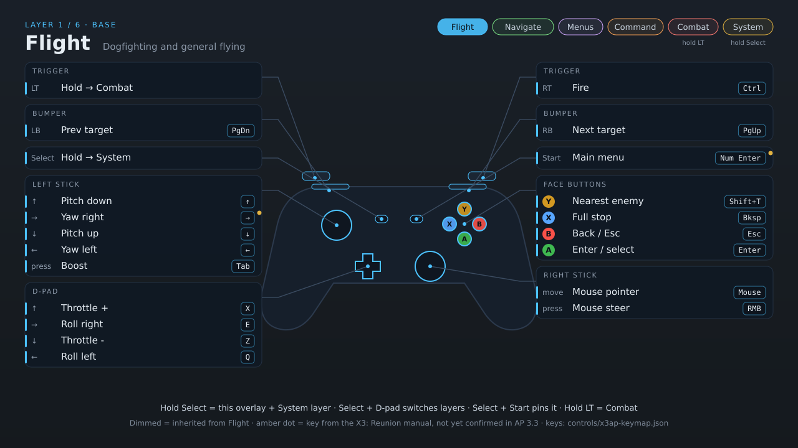

# 4. Controls: layers and help overlay

## Design

X3 has close to a hundred keyboard commands; a gamepad has 24 inputs (12 buttons, D-pad, two sticks
x 4 directions). This scheme reaches them through **layers**, built on TRASC's controller engine:

- **Bind actions, not keys.** Layers point at action IDs (`nav.seta`). `controls/x3ap-keymap.json`
  says which key each action sends (`KeyJ`). When Albion Prelude or LxXRM differs from the
  X3: Reunion defaults, fix it once in the keymap and every layer, the overlay and the cheat sheet
  follow.
- **Base layers + hold layers.** Four base layers you switch between, plus two momentary layers
  that are active only while a button is held. Releasing a hold returns you to where you were.
- **Inherit from Flight.** Any control a layer doesn't override keeps its Flight binding. Steering,
  fire and the two hold buttons therefore work everywhere.
- **Six layers.** That is TRASC's `MAX_LAYERS`. This preset uses all six; the fork can raise it.

| # | Layer | Reach it | Purpose |
| --- | --- | --- | --- |
| 1 | Flight | Select + D-pad ↑ | steer, throttle, roll, fire, targets, boost |
| 2 | Navigate | Select + D-pad → | SETA, dock, autopilot, jumpdrive, maps, views |
| 3 | Menus | Select + D-pad ↓ | menu arrows, fill/empty amounts, scroll, click |
| 4 | Command | Select + D-pad ← | command console, comms, property, player, 4 script hotkeys |
| 5 | Combat | **hold LT** | missiles, strafe on right stick, weapon groups, enemy cycling, wing orders |
| 6 | System | **hold Select** | layer switching, pause, save, options, screenshot, keyboard, help overlay |

All tables: [controls-cheatsheet.md](controls-cheatsheet.md). Overlay cards for every layer are in
[`overlay/`](../overlay).

## Help overlay

What you asked for: a helper that shows which key does what, summoned and dismissed at will.

- **Peek:** while **Select** is held, the overlay shows the full controller map. It starts with the
  System layer, whose D-pad jumps between base layers. Release Select and it disappears.
- **Pin:** **Select + Start** pins it; press again to unpin. A pinned overlay follows the active
  layer live, so you can hold LT and watch the Combat card appear.
- **Content:** a controller diagram with every input's action name and the X3 key it sends, the
  layer tabs (active one highlighted, hold layers labelled), dimmed rows for inherited bindings,
  and an amber dot for keys not yet confirmed in AP 3.3. The SVGs in `overlay/` are exactly this,
  generated from the same data.
- **Implementation:** a non-focusable Android `View` stacked above the game `SurfaceView`, the same
  approach as TRASC's top-centre layer label and `ClientOverlayPosition`. Nothing is injected into
  the game, so it works the same on both routes. It renders from
  `controls/generated/overlay-data.json` (source, label, short label, key, inherited, status per
  layer). Options: opacity, a "mini strip" (face buttons only), and **pause while pinned** (sends
  X3's Pause on pin/unpin).
- **Layer toast:** keep TRASC's 1.5 s layer-name label on every switch.

## Extended input vocabulary (X3 app additions to TRASC)

`ControllerInput.ACTIONS` has no numpad keys, Pause, PrintScreen, help or text-entry actions. The
format-2 export sets these to `None` (see `controls/generated/v2-compat-report.md`). Add them in the
fork:

| Token | X11 keysym / behaviour | Used by |
| --- | --- | --- |
| `NumpadEnter` | `XK_KP_Enter` | Main menu (X3R default) |
| `Numpad0`-`Numpad9`, `NumpadAdd`, `NumpadSubtract` | `XK_KP_0`..`XK_KP_9`, `XK_KP_Add`, `XK_KP_Subtract` | camera views, map cursor, zoom |
| `Pause` | `XK_Pause` | pause game |
| `PrintScreen` | `XK_Print` | alternative screenshot key |
| modifier + any key | e.g. `ShiftLeft+Period` | TRASC allows modifiers only on letters, digits, F-keys and Tab |
| `HelpOverlayToggle` | app action | `app.help_toggle` |
| `TextInput` | app action: open the Android IME, commit text as X11 key events | `app.text_input`; ship, station and save names |
| `Macro:[...]` (optional) | send a short key sequence | X3's numbered menus (e.g. Enter -> 4 -> 5) |

## Verified on the TRASC engine

`tools/trasc_check/run.sh <trasc checkout>` compiles your real `ControllerInput.java` together with
a harness. The harness loads the generated profile through TRASC's own `configure()` validation and
drives it with button presses. Current result: **all checks pass**. They cover:

- Hold Select enters System; Select + D-pad → lands on Navigate after release; SETA and dock
  (Shift+D) fire there.
- Holding LT from Navigate enters Combat; releasing it returns to Navigate.
- Select + D-pad ↓ / ← / ↑ reach Menus / Command / Flight. Script hotkey 1 sends Shift+F5.
- Select then LT: the most recent hold wins, and releasing unwinds correctly.
- Changing layer while a key is held releases it (no stuck keys).

**Caveat found by the harness:** X3's default fire key is **Left Ctrl**. Holding fire (RT) while
pressing another bound key sends a Ctrl-combo; for example, fire + Y sends Ctrl+Shift+T instead of
Shift+T. If X3 treats those differently, bind fire to a non-modifier key in X3 (Space, if free) and
change `weapons.fire` in the keymap.

## Keys still to confirm in Albion Prelude 3.3

The keymap marks these `verify`: yaw right (manual typo), autopilot `U` (the manual lists U twice),
auto-aim `K`, weapon groups `1`-`4`, weapons menu `G`, comms `C`, main menu `Num Enter`, zoom
`Num +/-`. Script hotkeys `script.1`-`script.6` (Shift+F5..F8, F10, F11) are **yours to bind in X3**
(Options -> Controls). LxXRM, Lucike's scripts and MARS register their hotkeys unbound; check those
keys are free first.

## Analog flight (Phase 5)

The keyboard layers give digital steering. AP 3.0 ("Shady Business") added controller support, so
the game can take analog axes if it sees a gamepad. Plan: a patched arm64 `libSDL2` that creates an
SDL virtual joystick fed by the app. Box32 (Route A) and Wine's SDL-based `winebus` (Route B) both
end up in native SDL2. A "Flight (analog)" profile then passes sticks and triggers through while the
other layers stay keyboard-based.

## Changing the scheme

1. Edit `controls/x3ap-lxxrm.profile.json` (which control does what) or `controls/x3ap-keymap.json`
   (which key X3 expects).
2. `python3 -I tools/build_controls.py` regenerates the TRASC profile, overlay data, cheat sheet and
   SVG cards. `--check` fails if anything is stale.
3. `tools/trasc_check/run.sh ../trasc-server-android` re-validates on the real engine.
